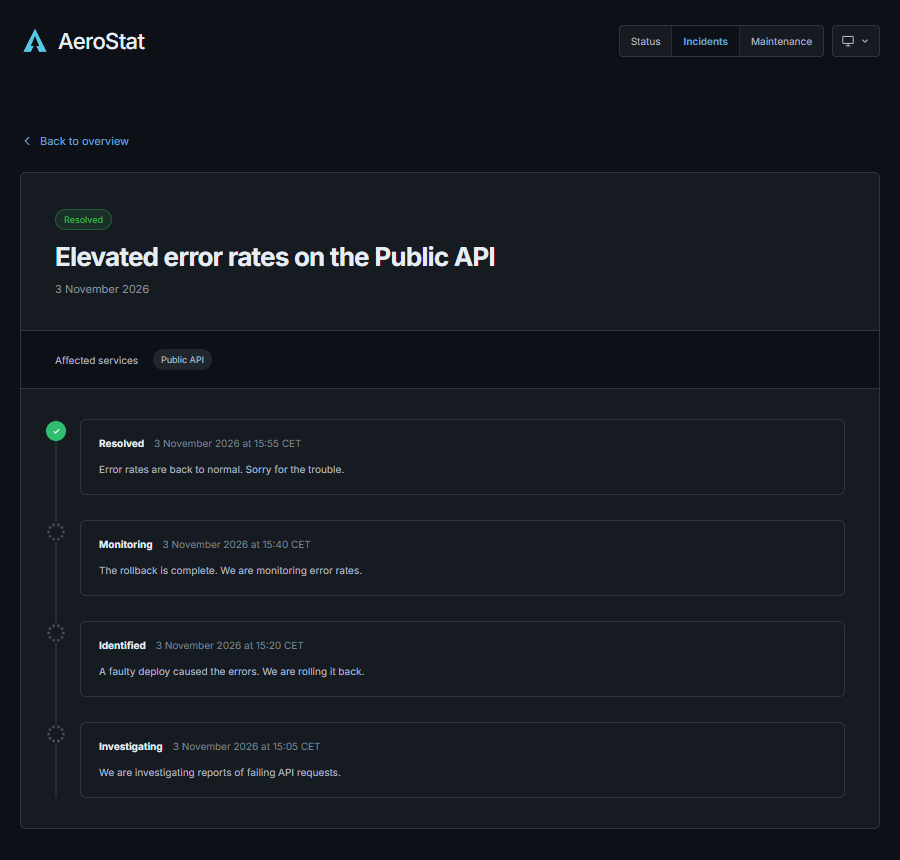
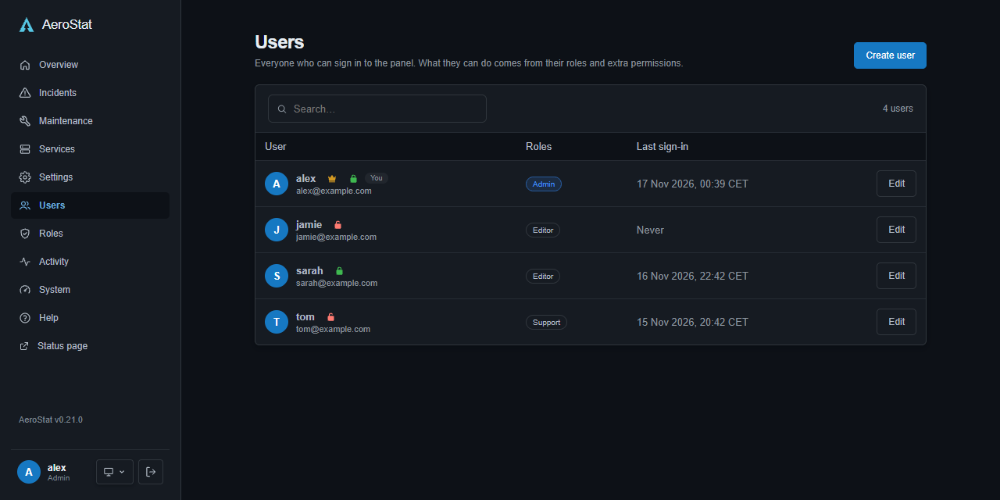
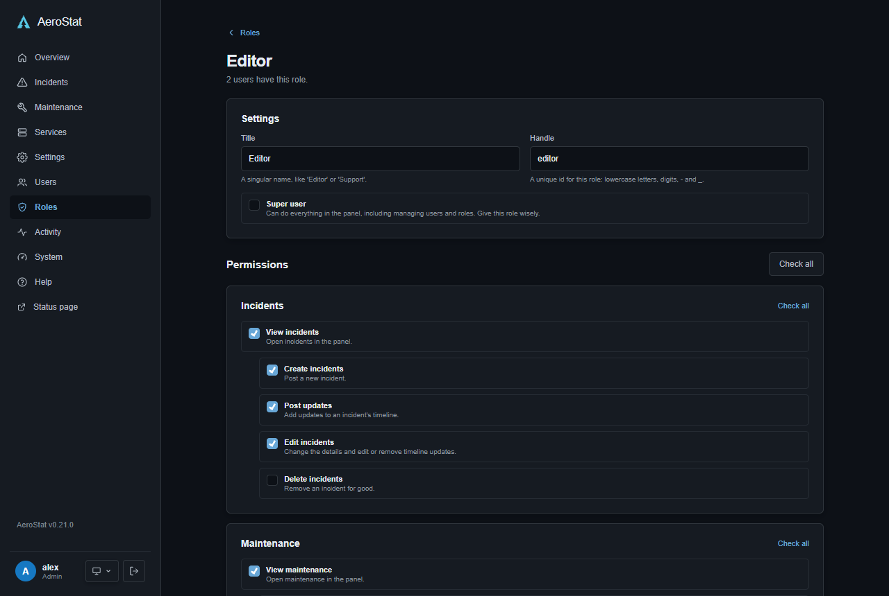
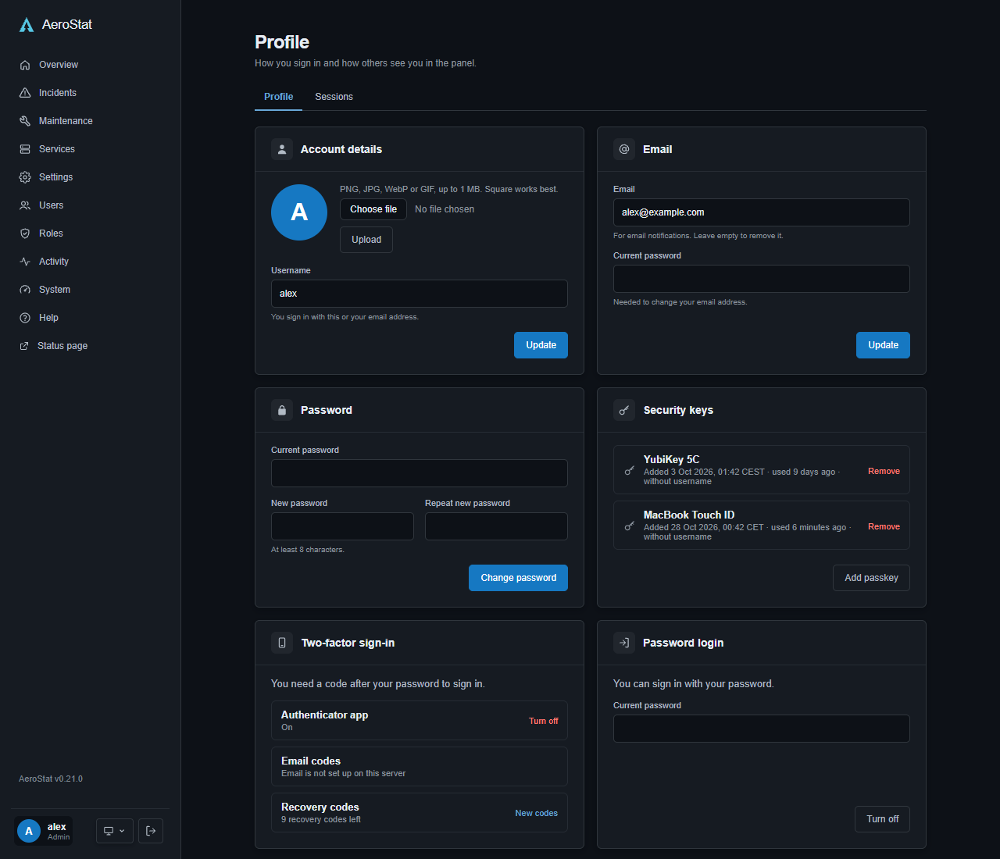
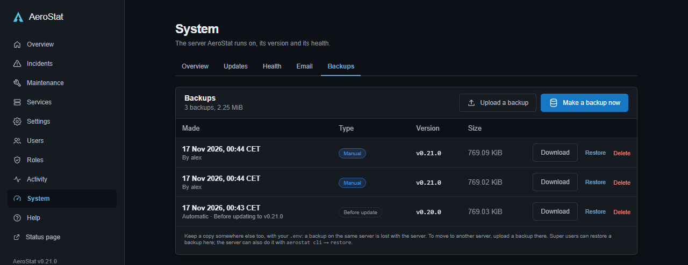
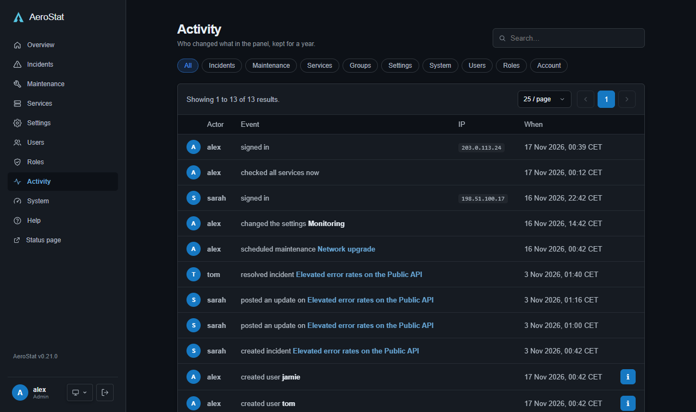
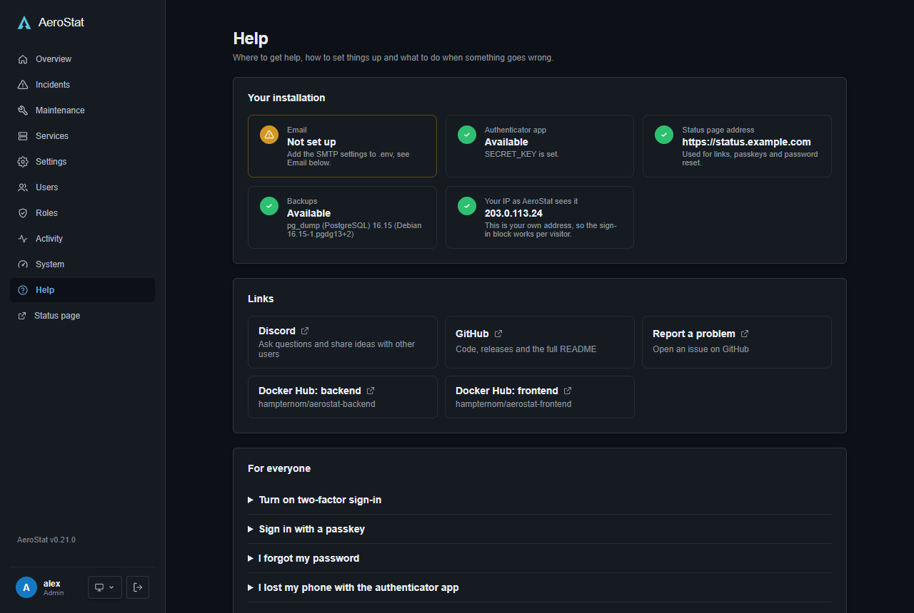
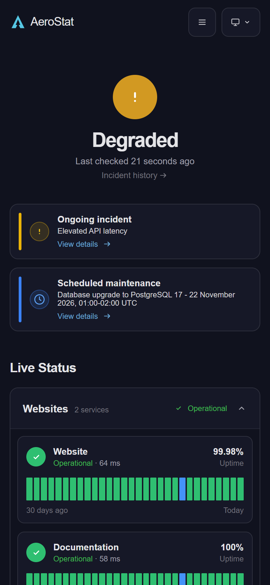
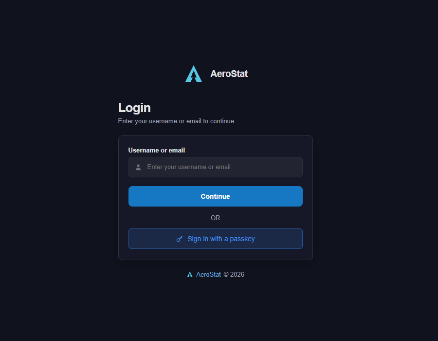

<div align="center">


# AeroStat

[](https://www.rust-lang.org/)
[](https://github.com/tokio-rs/axum)
[](https://nextjs.org/)
[](https://www.postgresql.org/)
[](https://redis.io/)
[](https://hub.docker.com/r/hampternom/aerostat-backend)
[](https://github.com/Hampter-0/AeroStat/blob/main/LICENSE)
[](https://docs.aerostatus.nl)

**A self-hosted status page with uptime monitoring, incidents and maintenance.**

AeroStat checks your services over HTTP(S), TCP and DNS, shows their uptime per day for the last 60 days,
and lets you post incidents and planned maintenance from a small admin panel.

Runs with Docker Compose next to Postgres and Redis, and is configured with a single `.env` file.

**[Documentation](https://docs.aerostatus.nl)** · **[Website](https://aerostatus.nl)** · **[Releases](https://github.com/Hampter-0/AeroStat/releases)**

<picture>
  <source media="(prefers-color-scheme: dark)" srcset="docs/screenshots/status-page.png" />
  <source media="(prefers-color-scheme: light)" srcset="docs/screenshots/status-page-light.png" />
  
</picture>

</div>

## Features

- Public status page with daily uptime bars, incidents and maintenance
- Incidents with their real start and end time: fill in Ended at to add one that is already over, date an update back, or move the end afterwards. Updates dated back send no notifications. A critical incident turns its days red and counts as downtime
- HTTP(S) checks with status codes and keywords, TCP port checks and DNS record checks, plus a warning before an HTTPS certificate runs out
- Admin panel at `/manage`: services and groups, incidents, maintenance, branding, users and roles with fine-grained permissions, activity log, live backend logs
- Sign in with a password or a passkey, see and sign out your sessions
- Light and dark mode, visitor-chosen timezone
- Public JSON status API and SVG status badges
- Discord and email notifications when a service goes down or comes back, and for incidents and maintenance
- Notifications that pop up in the panel while you work, and catch you up on what happened while you were away
- Security emails when someone changes their password, email address, passkeys or two-factor sign-in
- Link previews for Discord, Slack and social media that show the live status, incident or maintenance
- Rust backend (Axum, Postgres, Redis) and a Next.js frontend

## Screenshots

<table>
  <tr>
    <td></td>
    <td></td>
  </tr>
  <tr>
    <td align="center">Admin dashboard</td>
    <td align="center">Incident timeline</td>
  </tr>
  <tr>
    <td></td>
    <td></td>
  </tr>
  <tr>
    <td align="center">Users, roles and sign-in security</td>
    <td align="center">Permissions per role</td>
  </tr>
  <tr>
    <td></td>
    <td></td>
  </tr>
  <tr>
    <td align="center">Passkeys and two-factor sign-in</td>
    <td align="center">Backups</td>
  </tr>
  <tr>
    <td></td>
    <td></td>
  </tr>
  <tr>
    <td align="center">Activity log</td>
    <td align="center">Help and install checks</td>
  </tr>
  <tr>
    <td></td>
    <td></td>
  </tr>
  <tr>
    <td align="center">Status page on a phone</td>
    <td align="center">Sign-in</td>
  </tr>
</table>

## Install with Docker

You need a Linux server with Docker and the Compose plugin. Postgres and Redis come with AeroStat.

```bash
mkdir aerostat && cd aerostat
curl -O https://raw.githubusercontent.com/Hampter-0/AeroStat/main/deploy/docker-compose.yml
curl -o .env https://raw.githubusercontent.com/Hampter-0/AeroStat/main/deploy/.env.example
```

Fill in `.env` (the keys and the database password, see the [installation guide](https://docs.aerostatus.nl/guide/installation)), then start it and create your admin account:

```bash
docker compose up -d
docker compose exec -it backend aerostat create-admin --username admin
```

The status page is on `http://your-server:3000` and the panel on `http://your-server:3000/manage`.

## Documentation

Everything else is on **[docs.aerostatus.nl](https://docs.aerostatus.nl)**:

- [Installation](https://docs.aerostatus.nl/guide/installation), with your own Postgres
- [Reverse proxy and HTTPS](https://docs.aerostatus.nl/guide/reverse-proxy), with nginx, Caddy and Cloudflare
- [Updating](https://docs.aerostatus.nl/guide/updating) and [configuration](https://docs.aerostatus.nl/guide/configuration)
- [Monitoring](https://docs.aerostatus.nl/features/monitoring), [incidents and maintenance](https://docs.aerostatus.nl/features/incidents) and [notifications](https://docs.aerostatus.nl/features/notifications)
- [Users, roles and admins](https://docs.aerostatus.nl/features/users) and [sign-in security](https://docs.aerostatus.nl/features/sign-in)
- [Backups](https://docs.aerostatus.nl/features/backups) and the [status API and badges](https://docs.aerostatus.nl/features/api)
- [Command line](https://docs.aerostatus.nl/reference/cli) and [troubleshooting](https://docs.aerostatus.nl/reference/troubleshooting)
- [Development](https://docs.aerostatus.nl/reference/development): running it from source and releasing images

The docs live in [aerostat-docs](https://github.com/Hampter-0/aerostat-docs). Found a mistake? Every page has an edit link.

## License

AeroStat is released under the [MIT License](LICENSE).
